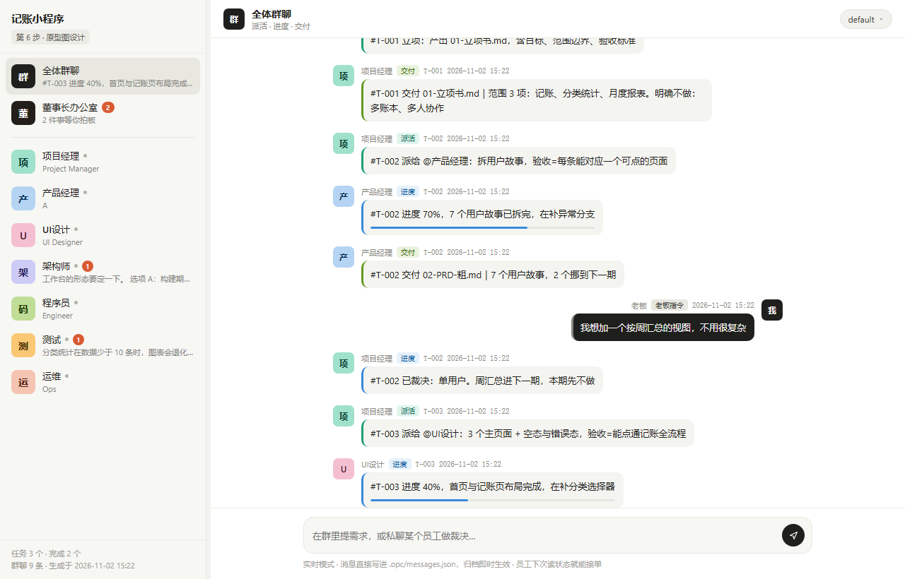
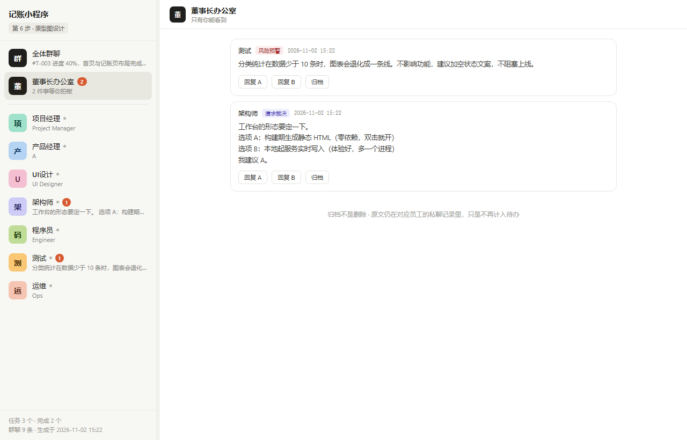
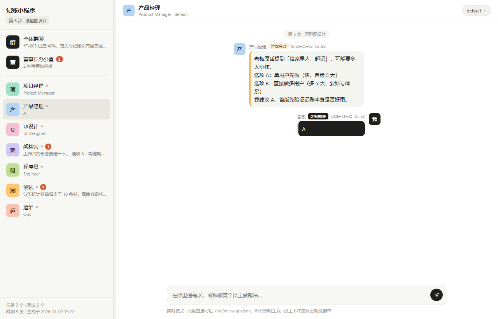

<p align="center">
  <picture>
    <source media="(prefers-color-scheme: dark)" srcset="docs/images/logo-dark.svg">
    
  </picture>
</p>

# One-Person Company

   

One-Person Company 是一个给 AI agent 用的技能。你提需求，七名 AI 员工按九步流程把它做到上线。你只需要两个动作：说清楚要什么，以及在必要时拍板。

它不需要 API Key，不需要服务端，不需要安装依赖，模型调用走宿主 agent 自己的额度。



## 安装

技能放在用户级目录，装一次，所有 agent 都能用。

**命令行**

```bash
# macOS / Linux
git clone https://github.com/culture-pig/one-person-company.git ~/.workbuddy/skills/one-person-company

# Windows (PowerShell)
git clone https://github.com/culture-pig/one-person-company.git "$env:USERPROFILE\.workbuddy\skills\one-person-company"
```

**不用 git**：下载仓库 zip，解压后把整个文件夹放进 `~/.workbuddy/skills/`，确认路径是 `.workbuddy/skills/one-person-company/SKILL.md`。

装完开一个新会话，说「开工」或「让产品经理先拆一版需求」。技能是会话启动时索引的，旧会话里还没生效就新开一个。

## 快速开始

```bash
OPC="python3 ~/.workbuddy/skills/one-person-company/scripts/opc.py --dir ."

$OPC init                                   # 开张，七名员工就位
$OPC task add --title "项目立项" --owner pm  # 派活
$OPC serve --open                           # 系统浏览器里打开工作台
```

`serve` 在 `127.0.0.1` 上起一个小服务并打开默认浏览器。重复执行不会起第二个，它会探到已在运行的实例直接复用。不想起服务也行：`$OPC build` 生成 `.opc/dashboard.html`，双击即可看，只是输入框降级为复制到剪贴板。

## 功能

### 群聊只管进度

群里只允许四类消息：`TASK` 派活、`PROGRESS` 进度、`DELIVER` 交付，以及你自己的 `BOSS` 发言。方案比较、风险分析、请示、寒暄，一句都不行。

这条约束是硬的，不是礼貌建议。模型天生爱在群里解释和辩论，一旦放开，群聊会退化成一堆自我辩论，你就再也看不见进度了。

### 私聊只谈取舍

员工遇到分歧、风险或需要你拿主意的事，走单线私聊，并且必须给选项和一个推荐 —— 你只回一个字母。



**董事长办公室**把所有人私聊里没结的事收在一页，每条可以直接回 A、回 B 或归档。

### 归档，而不是永远挂着

待裁决有两种结束方式：你给一个 `DECISION`，或者把这条归档。**归档不是删除**，原文留在私聊记录里，只是不再计入待办。

不加这条的话，`RISK` 类提示会永远挂在角标上。从 2 涨到 5 再涨到 10，你最后学会无视它 —— 那时候真正需要拍板的事也一起被无视了。

### 七名员工

| 代号 | 岗位 | 模型档位 | 负责 |
|---|---|---|---|
| `pm` | 项目经理 | reasoning | 立项、锁方案、派活、判门禁 |
| `pd` | 产品经理 | default | 两轮需求分析（粗 → 细） |
| `ui` | UI设计师 | default | 可交互原型、视觉规范 |
| `arch` | 架构师 | reasoning | 业务架构、接口文档、数据库文档 |
| `dev` | 程序员 | default | 编码实现 |
| `qa` | 测试 | lite | 测试用例与上线结论 |
| `ops` | 运维 | lite | 部署到生产环境 |

档位不绑具体型号。写死某个模型的配置三个月就过期，档位跟着宿主路由走，换套餐、换模型都不用改配置。档位可以重复。

每个岗位都写清了不做什么：产品经理不许定技术，架构师不许写业务代码，测试不许因工期放宽结论。越权一次，这套流程就废了。

### 九步流程与四道门禁

```
立项 →G1→ 粗需求 →方案锁定→G2→ 细需求 →原型∥架构→G3→ 编码 →G4→ 部署
```

| 门禁 | 通过条件 |
|---|---|
| G1 立项门 | 目标可验收、含 out-of-scope、里程碑有日期 |
| G2 方案门 | 原话逐条覆盖、周期资源已确认、降级项留痕 |
| G3 设计门 | 每个功能有接口、每张表有主键索引、选型有理由 |
| G4 上线门 | 测试结论为可以上线、无阻塞缺陷、回滚方式已写 |

两轮需求分析中间必须夹着方案锁定。合并成一轮是最常见的返工来源：范围没锁就细化，细完发现方向错了。

### 工作台

左边是群聊、董事长办公室和七名员工，右边是对话流，中间那条缝可以拖动调宽。消息按类型渲染成结构化卡片，进度百分比自动画成进度条。

用 `serve` 打开时是**实时模式**：输入框真的写进状态文件。在群里发话记成老板指令，私聊里发话记成裁决，点归档直接生效。用 `file://` 直接打开时自动降为只读模式，发送改为复制到剪贴板。



工作台发不出 `TASK`、`PROGRESS`、`DELIVER` —— 那是员工的话。这条在服务端硬拦，不是界面上把按钮藏起来。

### 产物链

每个阶段落到固定文件名，下游开工前必须先读上游，读不到就停下报错，不许凭记忆开工。

```
00-需求原话.md   老板原话，不改写
01-立项书.md     pm
02-PRD-粗.md     pd（粗）
03-PRD-细.md     pd（细，方案锁定后）
04-原型/         ui
05-架构/         arch
06-测试报告.md   qa
07-部署记录.md   ops
src/             dev
```

这些文件就是公司的记忆。换会话、换 agent、换模型，读一遍就能接着干。

## 数据

所有状态都在你项目根目录的 `.opc/` 下：

```
.opc/
├── company.json    公司、员工、当前阶段
├── tasks.json      任务、进度、门禁结果
├── messages.json   群聊与私聊的全部消息
├── dashboard.html  生成的工作台
└── docs/           产物链
```

文件即数据库。没有服务端，没有账号，没有云同步。整个 `.opc/` 目录加进 `.gitignore` 就不会污染你的仓库。

## 命令

| 命令 | 作用 |
|---|---|
| `init` | 初始化公司，建 `.opc/` 与七名员工 |
| `msg` | 追加消息，`--channel group` 或 `dm:<代号>` |
| `task add` / `set` / `list` | 派活、改进度、看列表 |
| `gate` | 门禁判定，`--result pass` 或 `reject` |
| `phase` | 查看或切换当前阶段 |
| `ack` | 归档待裁决，`--id M020` 或 `--channel dm:qa --all` |
| `status` | 打印公司现状与待裁决清单 |
| `build` | 生成自包含的 `dashboard.html` |
| `serve` | 本地起服务，浏览器里可写，`--open` 自动打开 |

消息类型：`TASK` `PROGRESS` `DELIVER` `BOSS`（群聊）｜`CHALLENGE` `RISK` `DECIDE` `DECISION`（私聊）。

## 做不到的事

写在这里，是因为它们常被当成功能来问。

| 想做的 | 实际能做到 | 原因 |
|---|---|---|
| 每个员工用不同的大模型 | 只能选档位（强推理 / 主力 / 快） | 零密钥前提下属主路由，拿不到具体型号 |
| 侧边栏一个独立入口 | 用工作台替代 | 侧边栏是宿主保留位，技能和插件都没有注入权限 |
| 七个员工同时跑 | 只有原型与架构并行 | 其余阶段严格串行，前一步产物是后一步的输入 |

这三条都写进了项目自己的 ADR（`05-架构/决策记录.md`），不是藏起来。哪天官方开放了，补上就是。

## 更新记录

每次 push 到 `main`，GitHub Actions 会把本次提交按「新功能 / 修复 / 文档 / 其他」归类，发布成一条 Release。所以写提交说明时带上 `feat:` `fix:` `docs:` 前缀。

最新一次看仓库右侧 [Releases](../../releases)，完整历史在 [CHANGELOG.md](CHANGELOG.md)。

## 目录结构

```
one-person-company/
├── SKILL.md                      技能主入口：四条铁律、档位表、标准动作
├── CHANGELOG.md                  人工整理的更新历史
├── references/
│   ├── roles.md                  七人职责、不做什么、私聊触发条件
│   └── protocol.md               双通道硬规则、门禁、产物链
├── scripts/
│   └── opc.py                    状态内核，纯标准库，无第三方依赖
├── assets/
│   └── dashboard_template.html   工作台模板
├── demo/
│   └── dashboard-preview.html    演示数据生成的工作台，可直接打开
└── .github/workflows/
    └── release-notes.yml         每次 push 自动生成 Release 说明
```

## 许可

[MIT](LICENSE)。随便用、随便改、商用也行。

## 免责声明

这是一个独立项目，与任何宿主 agent 产品的官方无关。AI 员工会读写你的文件、执行命令，也会消耗你的模型额度 —— 重要动作请自己过一眼。
